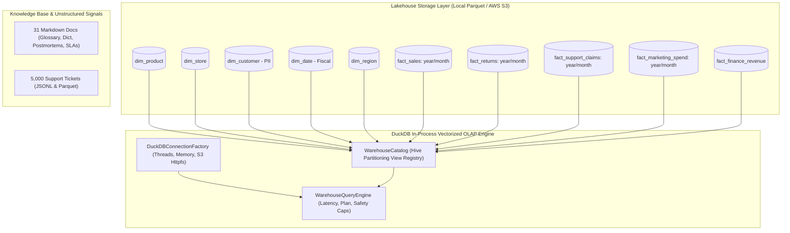

# OrchardIQ: Agentic Enterprise Analytics Platform

[](https://www.python.org/)
[](https://duckdb.org/)
[]()
[]()

> A production-style, multi-agent enterprise analytics and intelligence platform for **Orchard Inc.** (a global consumer-electronics enterprise). Built to demonstrate staff-level GenAI, data platform engineering, data governance, and lakehouse execution standards.

---

## Architecture Overview (Phase 1: Lakehouse & Data Engine)



---

## File Tree (Phase 1)

```
OrchardIQ/
├── .env.example                               # Production and local environment variables template
├── .env                                       # Local active environment settings
├── .gitignore                                 # Git rules for data artifacts and Python caches
├── pyproject.toml                             # Package manifest, dependencies, and pytest configuration
├── README.md                                  # Platform documentation and Phase 1 verification
├── docs/
│   ├── adr/                                   # Architecture Decision Records (Michael Nygard format)
│   │   ├── 0001-record-architecture-decisions.md
│   │   ├── 0002-duckdb-parquet-lakehouse.md
│   │   └── 0003-synthetic-star-schema-design.md
│   └── knowledge_base/                        # 31 Enterprise Markdown documents for RAG agent
│       ├── business_glossary/                 # Net Revenue, Attach Rate, Gross Margin, Return Rate, etc.
│       ├── data_dictionary/                   # Full table schemas, constraints, nullability, data types
│       ├── data_quality/                      # Freshness SLAs, PII governance policies, anomaly thresholds
│       ├── incident_postmortems/              # Root cause postmortems for 4 injected business stories
│       └── metrics_catalog/                   # Canonical metrics formulas and definitions
├── src/
│   ├── __init__.py
│   ├── config.py                              # Pydantic v2 settings with S3 and DuckDB configs
│   ├── data_gen/                              # High-performance synthetic lakehouse generator
│   │   ├── __init__.py
│   │   ├── cli.py                             # Rich CLI tool: orchardiq-generate
│   │   ├── generator.py                       # Vectorized PyArrow star-schema batch generator
│   │   ├── schema.py                          # Dimension models, schemas, and catalog metadata
│   │   ├── stories.py                         # 4 injected ground-truth stories with SQL verification
│   │   └── unstructured.py                    # Support tickets generator & docs publisher
│   └── warehouse/                             # DuckDB lakehouse execution engine
│       ├── __init__.py
│       ├── catalog.py                         # View registration over hive-partitioned Parquet & S3
│       ├── connection.py                      # DuckDB connection factory with httpfs extension
│       └── query_engine.py                    # Safe query execution, latency tracking, EXPLAIN plans
└── tests/
    ├── __init__.py
    ├── conftest.py                            # Temporary test environment & fixtures
    ├── test_injected_stories.py               # SQL verification of all 4 injected stories
    ├── test_synthetic_data.py                 # Determinism, partition structure, referential integrity
    └── test_warehouse.py                      # DuckDB connection, catalog views, query engine safety
```

---

## Injected Ground-Truth Stories (For Agent Evaluation)

1. **Story 1: APAC Q3 2025 PearPhone 16 Pro Battery Claims Spike**
   - **Root Cause**: Defective supplier cathode lot `BP-2025-08` from Shenzhen caused thermal degradation.
   - **Data Ground Truth**: > 50% of claims for `PRD-PHN-16P` in APAC during Q3 2025 are `Battery Degradation/Thermal`, tagged with batch `BP-2025-08`.
2. **Story 2: EMEA Q2 2025 Marketing Spend Slump Causing Retail Contraction**
   - **Root Cause**: Marketing funds were reallocated to North American WWPC keynote sponsorships, cutting EMEA digital search and social spend by 65%.
   - **Data Ground Truth**: EMEA retail sales in months 4, 5, and 6 contract by ~25% in direct correlation with the marketing spend collapse.
3. **Story 3: AMER Q4 2025 PearWatch Ultra 2 Holiday Attach-Rate Surge**
   - **Root Cause**: "Orchard Adventure Pro" holiday bundle offered $150 credit towards PearWatch Ultra 2 with PearPhone 16 Pro activations.
   - **Data Ground Truth**: PearWatch Ultra 2 attach ratio to PearPhone 16 Pro in AMER Q4 exceeds 40% (vs baseline ~13%).
4. **Story 4: PearBook Pro 16" Q1 2025 Display Flicker Return Surge**
   - **Root Cause**: PearOS firmware update v14.2 caused DisplayPort handshake clock synchronization regressions with external 6K displays.
   - **Data Ground Truth**: Hardware defect return rate spikes to > 7% in Jan/Feb 2025 before normalizing post-patch v14.2.1.

---

## Quickstart & Verification

### 1. Run the Test Suite
```powershell
.\.venv\Scripts\pytest -v
```

### 2. Inspect Lakehouse Catalog Views
```powershell
.\.venv\Scripts\python -m src.warehouse.catalog
```

### 3. Generate Warehouse Data (Fast Mode ~60k rows or Full Scale ~2.1M rows)
```powershell
# Fast test scale (~4 seconds)
.\.venv\Scripts\python -m src.data_gen.cli --fast

# Full production scale (~2,100,000 facts, 100,000 customers, 5,000 support tickets)
.\.venv\Scripts\python -m src.data_gen.cli --scale 1.0
```

### 4. Benchmark an Analytical Query Over ~2M Records
```powershell
.\.venv\Scripts\python -c "from src.warehouse.query_engine import WarehouseQueryEngine; qe = WarehouseQueryEngine(); res = qe.execute_query('SELECT p.product_name, SUM(s.units) as units_sold, ROUND(SUM(s.net_revenue)/1e6, 2) as net_rev_millions FROM fact_sales s JOIN dim_product p ON s.product_id = p.product_id GROUP BY 1 ORDER BY 3 DESC LIMIT 5;'); print(f'Executed in {res.latency_ms} ms:'); [print(r) for r in res.rows]"
```
*(Executes in ~145ms across 1.96M sales rows on DuckDB).*
