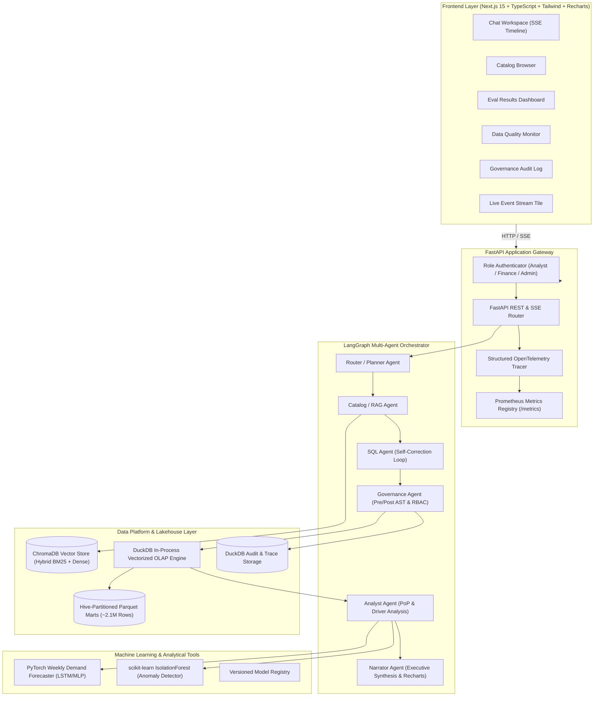
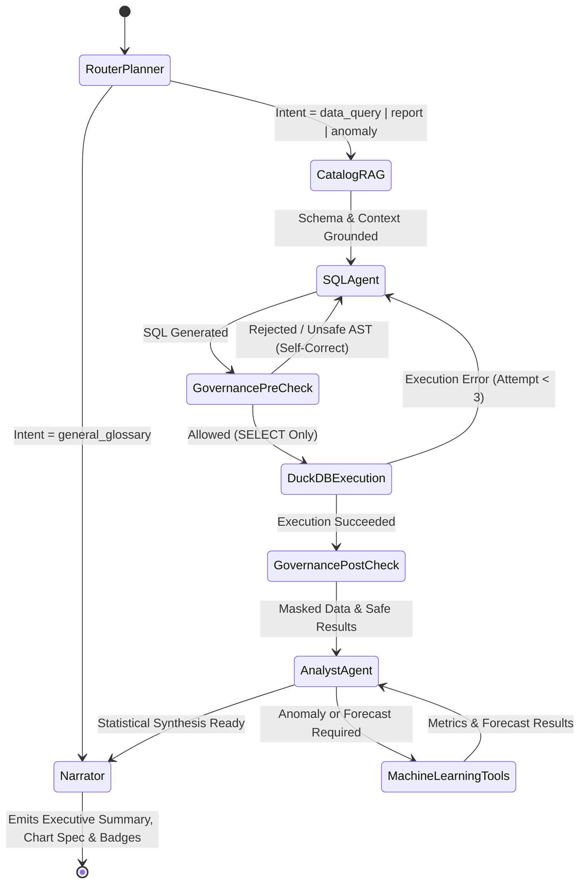
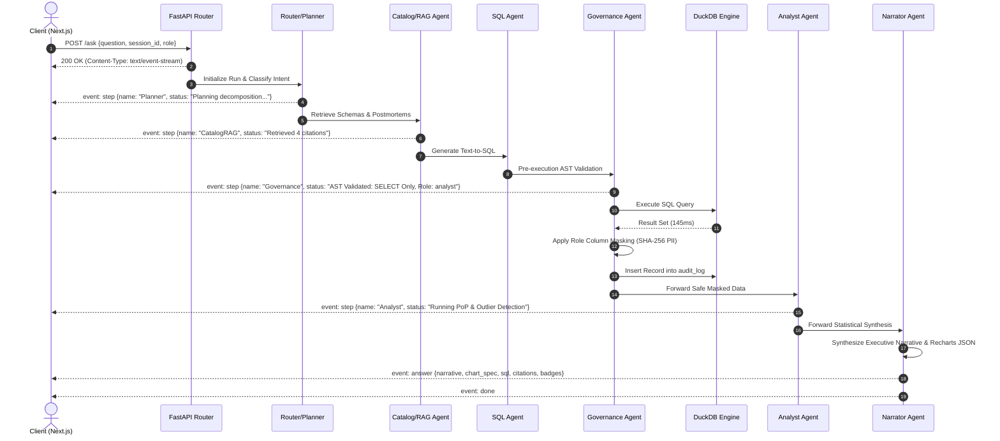
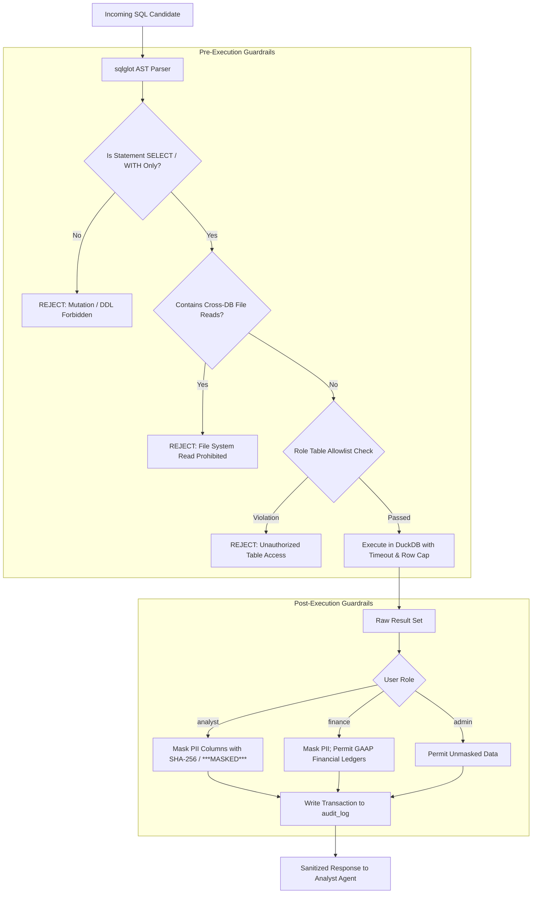

# OrchardIQ Technical Architecture & System Design

## 1. System Overview & Component Diagram

OrchardIQ couples an in-process vectorized analytical lakehouse (DuckDB over partitioned Parquet) with an enterprise knowledge vector store (ChromaDB) orchestrated by a multi-agent state graph (LangGraph) and served via FastAPI and Next.js 15.



---

## 2. LangGraph Multi-Agent Graph Architecture

The multi-agent workflow is implemented as an explicit LangGraph state machine rather than an unstructured monolithic chain. Each node mutates a strictly typed `AgentState` object.



### State Schema (`AgentState`)
```python
class AgentState(TypedDict):
    session_id: str
    run_id: str
    question: str
    user_role: str  # analyst, finance, admin
    intent: str     # data_query, definition, forecast, anomaly, report
    plan_steps: List[str]
    citations: List[Dict[str, Any]]
    retrieved_context: str
    sql_query: Optional[str]
    sql_attempts: List[Dict[str, Any]]
    raw_results: Optional[List[Dict[str, Any]]]
    masked_results: Optional[List[Dict[str, Any]]]
    statistical_findings: Optional[Dict[str, Any]]
    ml_output: Optional[Dict[str, Any]]
    governance_decision: Dict[str, Any]
    narrative: Optional[str]
    chart_spec: Optional[Dict[str, Any]]
    follow_up_questions: List[str]
    trace_events: List[Dict[str, Any]]
```

---

## 3. Sequence Diagram for `POST /ask` (SSE Streaming)



---

## 4. API Contracts & Endpoints

| Method | Endpoint | Description | Request Body / Query | Response Model |
|---|---|---|---|---|
| `POST` | `/ask` | Streaming multi-agent query endpoint | `AskRequest` (`question`, `session_id`, `role`, `include_trace`) | Server-Sent Events (`event: step`, `event: answer`, `event: done`) |
| `GET` | `/sessions/{id}` | Retrieve session history and saved insights | Path: `id` | `SessionHistoryResponse` |
| `GET` | `/trace/{run_id}` | Retrieve execution trace and latency | Path: `run_id` | `TraceResponse` (steps, latency, tokens, cost) |
| `GET` | `/catalog/search` | Semantic and keyword catalog search | Query: `q`, `category`, `limit` | `CatalogSearchResponse` (tables, metrics, postmortems) |
| `POST` | `/forecast` | Run PyTorch weekly demand forecaster | `ForecastRequest` (`product_id`, `weeks_ahead`, `horizon`) | `ForecastResponse` (projected units, MAPE, confidence bounds) |
| `GET` | `/quality/report` | Lakehouse Data Quality health report | None | `DataQualityReport` (freshness, null rates, drift) |
| `GET` | `/audit` | Retrieve governance audit log entries | Query: `limit`, `role`, `flagged_only` | `AuditLogResponse` (queries, roles, decisions, timestamps) |
| `GET` | `/health` | System readiness and lakehouse status | None | `HealthResponse` (`status: ok`, `duckdb: ok`, `chroma: ok`) |
| `GET` | `/metrics` | Prometheus format platform metrics | None | Text (`text/plain; version=0.0.4`) |

---

## 5. Security & Governance Architecture (RBAC & Defense-in-Depth)



### Role-Based Access Matrix

| Role | Allowed Tables | PII Masking (`dim_customer`) | Row Limit | Finance Reconciliation Access |
|---|---|---|---|---|
| `analyst` | `fact_sales`, `fact_returns`, `fact_support_claims`, `fact_marketing_spend`, `dim_*` | **Masked** (`email`, `phone`, `first_name`, `last_name`, `address`) | 1,000 rows | Aggregated only |
| `finance` | All tables including `fact_finance_revenue` | **Masked** | 5,000 rows | **Full GAAP & Deferred Ledgers** |
| `admin` | All tables | **Unmasked** (Audited) | 10,000 rows | Full Access |

---

## 6. Failure Modes & Autonomous Self-Healing

| Failure Scenario | Detection Mechanism | Self-Healing / Mitigation Strategy |
|---|---|---|
| **SQL Syntax / Runtime Error** | DuckDB exception caught in `SQLAgent` | Autonomous self-correction loop (up to 3 retries) sending error context back to LLM. |
| **Prompt Injection Attack** | AST validation & regex prompt shield | SQL blocked immediately; security warning injected; security incident recorded in `audit_log`. |
| **Query Timeout (>30s)** | DuckDB execution thread timeout | Query terminated; agent notified; plan decomposed into smaller partitioned intervals. |
| **LLM Provider API Outage** | Anthropic API connection timeout or rate limit | Fallback to deterministic `MockLLM` with cached golden-response repository (ensuring live demo never fails). |
| **Vector Store Cold Start** | ChromaDB collection missing | Automated on-demand indexing job triggered from `docs/knowledge_base/` and `data/unstructured/`. |
